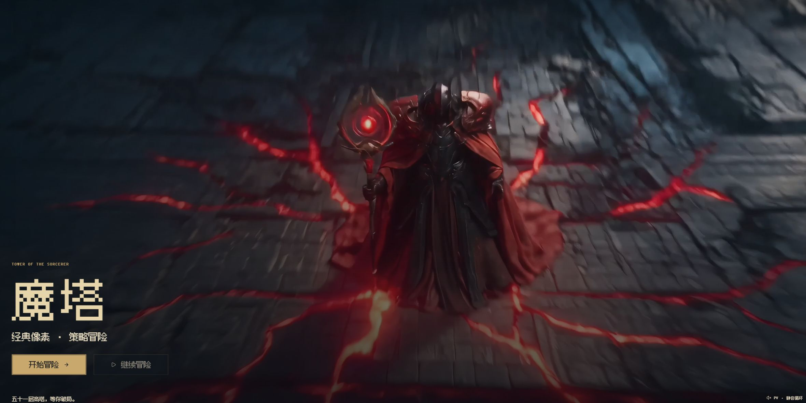
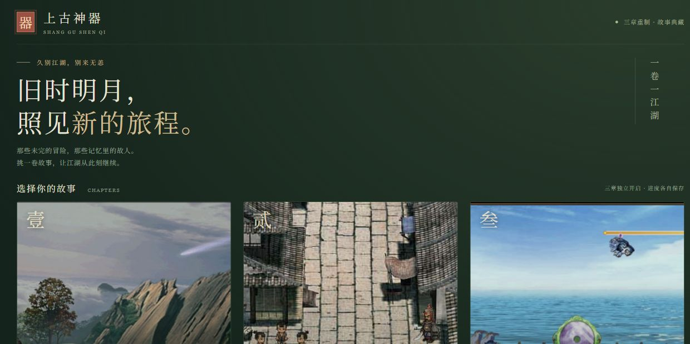
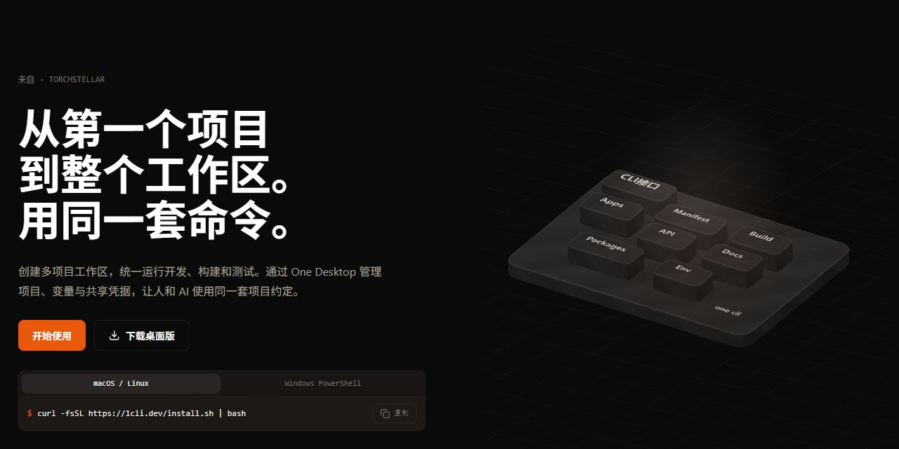

### Hi there, I'm caorushizi 👋

Blog：[caorushizi's blog](https://caorushizi.cn)

**Languages and Tools:**  

  

### My Projects

<table>
  <tr>
    <td width="33%" valign="top">
      
      <h3><a href="https://caorushizi.github.io/mota/">魔塔</a></h3>
      
经典像素策略冒险，在五十一层高塔中规划路线、挑战怪物。

      
<a href="https://caorushizi.github.io/mota/">开始冒险 →</a>

    </td>
    <td width="33%" valign="top">
      
      <h3><a href="https://caorushizi.github.io/shenqi/">上古神器</a></h3>
      
三章独立的江湖冒险，重温昆仑、月河与仙岛的故事。

      
<a href="https://caorushizi.github.io/shenqi/">进入江湖 →</a>

    </td>
    <td width="33%" valign="top">
      
      <h3><a href="https://www.1cli.dev/">One CLI</a></h3>
      
面向人和 AI 的工作区工具，统一项目创建、开发、构建与测试。

      
<a href="https://www.1cli.dev/">了解项目 →</a>

    </td>
  </tr>
</table>

